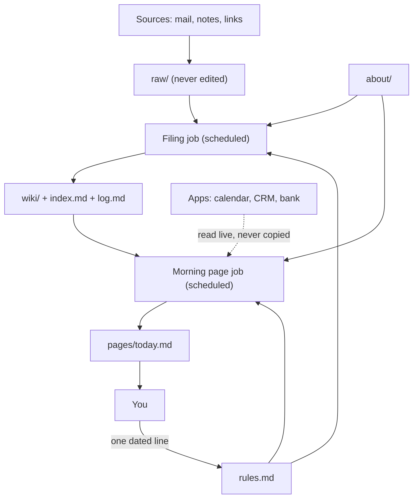

# The Brain Is a Folder

**A second brain is a folder an AI reads before every task, plus a few scheduled jobs that keep it fed while you are away.**

By the end you will know what goes in that folder, how the jobs keep it current, and which parts you should not trust. The model is replaceable. The folder is the asset.

> **Credit where it is due.** The chapter structure here is inspired by Argona's course on building a second brain [[1]](SOURCES.md). We paraphrase it, we never reproduce its prompts, and every template in this repo is original. The course is tied to one product. This repo is the vendor-neutral version, with every claim sourced, plus the part the course skips: what breaks.

---

## The problem: every chat starts at zero

Most people use an AI assistant like a stranger at a front desk. Every new chat, you explain who you are, what you are working on, how you like things written, and who the people in your life are. Then the chat ends and all of it is gone. The course this repo adapts opens with the same complaint: each new chat starts from nothing [[1]](SOURCES.md).

Built-in memory helps a little, but it is not the same thing as a file. Memory features keep short summaries that the assistant wrote about you, and summaries drift. In one tool's own docs, the assistant-written memory is capped: only the first 200 lines or 25KB are loaded each session [[21]](SOURCES.md). A file you wrote stays exactly as you wrote it. The course makes the same point: store the brain as files, and leave chat out of it [[1]](SOURCES.md).

So the fix is boring, and that is why it works. Put what the assistant needs to know in a folder. Make the assistant read the folder first, every time.

---

## The one idea: the brain is a folder

> **Like you're five.**
> Imagine you hire a new assistant every single morning.
> They are smart, but they have never met you.
> So you leave a notebook on the desk.
> They read it before they start work, and they write new notes in it before they leave.
> Tomorrow a different assistant can sit down, read the same notebook, and carry on.
> The assistant can change. The notebook stays.

That is the whole design. The notebook is a plain folder of text files. Any assistant that can read files can use it. If a better assistant shows up next year, you point it at the same folder and nothing is lost.

> **In engineer words.**
> **Harness**: the program that wraps a model, gives it tools and files, and runs it in a loop. Examples are listed in the table below.
> **Instructions file**: a plain file the harness loads at the start of every run. Ours is `AGENTS.md`.
> **Scheduled job**: a run that starts on a timer, with no one at the keyboard. It is how the folder gets fed while you are away.
> **Context**: the text the model can see right now. Longer is not always better; see [what breaks](#what-breaks).

The folder looks like this. We use this exact layout everywhere in the repo.

```
brain/
  AGENTS.md            the first file every run reads; short, points to the rest
  about/
    me.md              who you are, what you are working on, who matters
    voice.md           how you write, with examples
  rules.md             one dated line per correction, newest first
  raw/                 everything that comes in, never edited
  wiki/
    index.md           the map; read before anything else in wiki/
    log.md             what was filed, when
    ...                one page per person, project or topic
  decisions/           one dated note per decision, with an empty Outcome
  pages/               morning pages and weekly reviews
  skills/              one folder per skill, each with a SKILL.md
  out/                 finished work
```

---

## Where this came from

**The spark.** On 2 April 2026, Andrej Karpathy posted "LLM Knowledge Bases" on X [[2]](SOURCES.md). The recipe: collect source material (articles, papers, repos, images) into a `raw/` directory, then have a language model incrementally "compile" that pile into a wiki of Markdown files [[2]](SOURCES.md). The model writes and maintains the wiki, the human mostly reads it, answers get filed back in, and the model runs periodic "health checks" to find inconsistencies [[2]](SOURCES.md). When we read the post on 2026-10-16 it showed 21,974,705 views [[2]](SOURCES.md).

One detail matters for everything below. His own wiki was about 100 articles and 400K words, and at that size he found that index files and short summaries worked without fancy retrieval (searching chunks of text and pasting the best ones into the prompt, often called RAG) [[2]](SOURCES.md). He was explicit that this was a small scale [[2]](SOURCES.md). Two days later he published a gist, a short design note, describing a model that "incrementally builds and maintains a persistent wiki" instead of rediscovering knowledge from scratch on every question [[3]](SOURCES.md). The gist's argument for why people abandon wikis is that upkeep grows faster than the value, and that the model can absorb the upkeep. That is the author's claim, not a measured result [[3]](SOURCES.md).

**The lineage.** The idea is older than the models.

- Tiago Forte's Building a Second Brain method is built on CODE (Capture, Organize, Distill, Express) and PARA (Projects, Areas, Resources, Archive) [[6]](SOURCES.md). Our folder borrows the habit: capture first, organize lightly, distill into something you can use.
- Niklas Luhmann kept a card index (a Zettelkasten) of some 90,000 cards, linked by unique index numbers in a branching hierarchy. That figure comes from Wikipedia, a secondary source [[7]](SOURCES.md). The lesson we keep is that links between notes do most of the work.
- On the agent side, the MemGPT paper borrowed from the memory tiers of operating systems to give models memory beyond their context window [[8]](SOURCES.md). The Generative Agents paper added reflection: agents synthesize memories over time into higher-level summaries and retrieve them later to plan [[9]](SOURCES.md). The weekly review in this repo is a human-sized version of that reflection.

**The always-on turn.** Argona's course, published on 13 October 2026, makes a practical argument [[1]](SOURCES.md). The popular builds live on a laptop and only work while a particular app stays open. A bot running on a cloud computer does not have that limit [[1]](SOURCES.md). The course points to Kevin Rose's demo, a Grok Bot that indexes saved Instagram videos into a wiki-style Markdown index [[5]](SOURCES.md). He posted it on 19 September 2026, and on 2026-10-16 it showed 694,456 views [[5]](SOURCES.md). The course is promotional for its own product, so read it with that in mind. The chapter structure is still a good one, and it is the skeleton of this repo [[1]](SOURCES.md).

> **A note on "85,000 bookmarks".** The course says one post sharing a build of the Karpathy idea has 85,000 bookmarks, but it names no post for that figure [[1]](SOURCES.md). The closest match we found is Ridark's post summarizing a popular build guide, which showed 84,606 bookmarks when we read it on 2026-10-16 [[4]](SOURCES.md). That match is our inference; the course does not say so. For scale, Karpathy's own post showed 108,509 bookmarks on the same date [[2]](SOURCES.md). We do not think anyone was careless here. We are only showing our working.

---

## Three rules that make it work

### Rule one: files, not chat memory

> **Like you're five.**
> If you tell a friend a story, they remember their version of it.
> If you write it on a card, the card remembers yours.
> Always trust the card.

The folder is the source of truth. Chat history and built-in memory are convenient, but they hold summaries written by the assistant [[21]](SOURCES.md) [[1]](SOURCES.md). In our view, a summary can drift from what you actually said. If something matters, it goes in a file, in your words. If the assistant remembers something useful, ask it to write that into the folder so it survives a change of tool.

### Rule two: slow facts in files, fast facts at the source

> **Like you're five.**
> Your friend's birthday does not change, so write it in the notebook.
> Whether the bakery is open right now does change, so do not write it down.
> Walk over and look.

Some facts hardly ever change: who your accountant is, how you like emails signed, what a project is for. Those are slow facts, and they live in files. Other facts change all the time: what is on your calendar, whether an invoice is paid, how much is in an account. Those are fast facts. Copying them into a file just creates a stale copy that looks trustworthy. Instead, each run reads fast facts from the app they live in, at the moment it needs them [[1]](SOURCES.md). The file can hold a pointer ("check the calendar") but not the answer.

> **In engineer words.** Per its README, one builder's linter classifies every stored fact as timeless, dated, or a pointer, so a bare count or status cannot sit in a page and silently rot [[36]](SOURCES.md). That is the same rule from the other direction.

### Rule three: every correction becomes one dated line

> **Like you're five.**
> The first time the assistant gets it wrong, you tell them.
> The second time, you do not want to tell them again.
> So you write it on a sticky note and put it where they will see it first.

When the assistant gets something wrong, you do not just fix the output. You add one dated line to `rules.md`, and every run reads that file before it starts. One builder calls the same idea a rulings folder, where every correction becomes one dated line that each run reads before drafting [[13]](SOURCES.md). Over weeks, the assistant stops repeating the mistakes you have already named. Chapter six shows how to write good ones and how to keep the file from growing forever.

---

## The five building blocks

Every major harness we checked offers the same five blocks, under different names. Learn the blocks and you can move the brain from one harness to another.

1. **An always-loaded instructions file.** A short file read at the start of every run.
2. **Persistent files.** Somewhere the folder actually lives and survives between runs.
3. **Runs while your laptop is closed.** Scheduled jobs that execute somewhere other than your machine.
4. **Mail and calendar connectors.** Permitted, ideally read-only, access to the places fast facts live.
5. **Reusable skills.** Saved procedures the assistant can load when a task matches.

Here is how each column fills them in. Each header links to a short adapter file with the same five questions answered in the same order. Where our sources say nothing, the cell says so rather than guess.

| Block | [Claude Code](adapters/claude-code.md) | [Codex / ChatGPT](adapters/codex-and-chatgpt.md) | [Gemini CLI](adapters/gemini-cli.md) | [Grok Bot](adapters/grok-bot.md) | [Local (open model)](adapters/local.md) |
|---|---|---|---|---|---|
| Always-loaded instructions file | `CLAUDE.md` is read at the start of every session; it can read `AGENTS.md` in its place [[21]](SOURCES.md) | `AGENTS.md`, walked from the global folder down to your working directory; closer files win [[24]](SOURCES.md) | `GEMINI.md`, with a setting that can list other names such as `AGENTS.md` [[27]](SOURCES.md) | Not in our sources | Depends on the agent you run; not in our sources |
| Persistent files | Your repo, plus a separate auto-memory the assistant writes itself [[21]](SOURCES.md) | Local files for desktop tasks; web tasks use uploaded context only [[25]](SOURCES.md) | Workspace files, with `@file.md` imports [[27]](SOURCES.md) | A cloud computer with a filesystem [[28]](SOURCES.md) | Your own disk; some open agents add local memory search [[30]](SOURCES.md) |
| Runs while your laptop is closed | Routines run in the vendor's cloud, minimum interval one hour (research preview) [[22]](SOURCES.md) | Web and cloud tasks yes; desktop tasks need the computer on [[25]](SOURCES.md) [[26]](SOURCES.md) | Not covered by the sources we checked; check the current docs | Scheduled or event-triggered runs on its cloud computer [[28]](SOURCES.md) | No, unless you leave a machine powered on [[29]](SOURCES.md) |
| Mail and calendar connectors | Hosted connectors for Gmail and Google Calendar [[23]](SOURCES.md) | Gmail and Google Calendar connected under Plugins [[26]](SOURCES.md) | Extensions can bundle connector servers; no mail connector named in our sources [[27]](SOURCES.md) | Gmail, Google Calendar and Drive [[28]](SOURCES.md) | Some agents support connector servers; mail not in our sources [[30]](SOURCES.md) |
| Reusable skills | Documented; follows the open skills standard [[31]](SOURCES.md) | Documented; a skill can preserve a task's method [[31]](SOURCES.md) [[26]](SOURCES.md) | Documented, with a shared skills folder alias [[31]](SOURCES.md) | Says it supports the same skills as another coding tool [[28]](SOURCES.md) | Not in our sources |

The table is a snapshot of documentation that carries no dates and that vendors change often. The Gemini CLI column is the most likely to be out of date; [its adapter](adapters/gemini-cli.md) explains why [[27]](SOURCES.md). Check the live docs before you commit.

**The cross-vendor trick.** Write your instructions once, in a file called `AGENTS.md`. It is an open format, stewarded by a foundation, and its homepage lists a long line of coding tools that read it [[32]](SOURCES.md). In our checks, [Codex](adapters/codex-and-chatgpt.md) reads it natively [[24]](SOURCES.md), [Gemini CLI](adapters/gemini-cli.md) can be set to read it [[27]](SOURCES.md), and [Claude Code](adapters/claude-code.md) can read it in place of its own file [[21]](SOURCES.md). So one file in one place covers most of the table.

**Skills travel too.** A skill is a folder with a `SKILL.md` file in it, written to an open specification [[31]](SOURCES.md). Because the format is shared, the skills you build in chapter five move with the folder.

---

## The architecture

Here is the whole system on one page. The dotted edge is the one thing read live. Everything else is a file in the folder.



Read it top to bottom. Things arrive in `raw/` and are never edited. A scheduled filing job turns them into wiki pages and keeps `index.md` and `log.md` up to date. A second scheduled job builds your morning page from the wiki, plus live facts it reads from your apps. You read the page, correct what is wrong, and each correction becomes a line in `rules.md`. Both jobs read `about/` and `rules.md` first, every run.

Two details are easy to miss. The filing job and the morning job are separate on purpose, so that the one that reads untrusted mail cannot do much else (see [what breaks](#what-breaks)). And the apps are never copied into the wiki: slow facts are filed, fast facts are fetched.

---

## The seven chapters

The chapter topics follow Argona's course [[1]](SOURCES.md), described here in our own words, with one chapter added.

- [Chapter one: a file about you](docs/01-a-file-about-you.md). Build `about/me.md` and `about/voice.md` from your sent mail, or from an interview.
- [Chapter two: the folder](docs/02-the-folder.md). The layout, slow versus fast facts, and what must never go in it.
- [Chapter three: filing](docs/03-filing.md). How mail and notes move from inbox to `raw/` to the wiki, on a schedule.
- [Chapter four: the morning page](docs/04-the-morning-page.md). One page that tells you what is true, what is guessed, and what needs your yes.
- [Chapter five: skills](docs/05-skills.md). Do a task once, make it reliable, save it, then automate it.
- [Chapter six: rules](docs/06-rules.md). Dated corrections, the weekly review, and health checks.
- [Chapter seven: one paste](docs/07-one-paste.md). Bootstrap the whole thing in a single message, with a yes required before any job turns on.
- [Chapter eight: what breaks](docs/08-what-breaks.md). The chapter the course does not have.

---

## What breaks

A brain you never question is a liability. The short version, with the long version in [chapter eight](docs/08-what-breaks.md):

- **Context rot.** Models do worse as their input gets longer. A study of 18 language models found performance consistently degrades with input length [[10]](SOURCES.md), and an earlier academic paper found accuracy drops when the relevant fact sits in the middle of a long input [[11]](SOURCES.md). This is why the index beats dumping everything in.
- **Scale and cost.** Index-first worked at about 100 articles [[2]](SOURCES.md). One practitioner warns that agents navigate large folders by brute force, which costs tokens (the units models bill by) and can miss critical information [[14]](SOURCES.md). A vendor post claims raw compilation breaks down at larger volumes through cost, duplicates and conflicting facts; that post sells its own fix, so treat it as unverified [[15]](SOURCES.md).
- **Staleness and upkeep.** The gist that started this wave says wikis die because upkeep outpaces value [[3]](SOURCES.md). A separate promotional post says a hand-built setup means wiring a vault, agents, schedules and integrations, then babysitting them [[17]](SOURCES.md). A practitioner who built a company brain called the payoff unproven after one week [[14]](SOURCES.md).
- **Prompt injection through your mail.** If your filing job reads email, anyone who can email you can try to give your assistant instructions. A standards body describes indirect prompt injection as what happens when a model is fed text from outside places, like web pages or documents [[19]](SOURCES.md).
- **Memory poisoning.** One paper shows an attacker planting malicious records in an agent's memory using only ordinary queries, with no direct write access. The success rates are the authors' own [[20]](SOURCES.md).

Say it plainly: wiring your inbox into an always-on agent is the lethal-trifecta setup. Simon Willison's framework lists three capabilities that together make an agent exploitable for data theft: access to your private data, exposure to untrusted content, and the ability to communicate externally [[18]](SOURCES.md). An inbox-reading agent that can also send mail has all three. The course this repo adapts does not discuss it. Our guardrails are in chapters three and eight: read-only connectors, a quarantined `raw/`, drafts instead of sends, and a human who promotes anything into `about/` or `rules.md`.

---

## Prior art worth stealing

Twelve open-source projects that build some version of this. Star counts were read through the GitHub API on 2026-10-16, US time; push dates are in UTC, so a few show 2026-10-17 ([sources 33 to 44](SOURCES.md#open-source-builds-read-via-the-github-api-on-2026-10-16)). We read each project's README but did not run them, so every row is "per its README". Pick the one idea you like, not the whole project.

| Project | Stars | Where the brain lives | Model lock-in | One idea worth stealing |
|---|---|---|---|---|
| [garrytan/gbrain](https://github.com/garrytan/gbrain) [[33]](SOURCES.md) | 30,928 | Markdown repo indexed into an embedded or full Postgres database | Works with many harnesses over a connector standard; embedding providers configurable | Auto-linking by plain pattern matching on page references, so the graph needs no model call |
| [khoj-ai/khoj](https://github.com/khoj-ai/khoj) [[34]](SOURCES.md) | 37,713 | Not stated in its README | Any local or online model | One product from on-device to cloud, with agents that bundle knowledge, persona, model and tools |
| [AgriciDaniel/claude-obsidian](https://github.com/AgriciDaniel/claude-obsidian) [[35]](SOURCES.md) | 15,587 | Plain Markdown and JSON in a note-taking vault, plus a local keyword index | Built for Claude Code first; portable skills; setup scripts for others | Parallel workers return drafts only, and one orchestrator applies the change as a single recoverable transaction |
| [eugeniughelbur/obsidian-second-brain](https://github.com/eugeniughelbur/obsidian-second-brain) [[36]](SOURCES.md) | 4,787 | Plain Markdown in a vault or any folder | Several agents | A linter forces every stored fact to be timeless, dated, or a pointer |
| [nashsu/llm_wiki](https://github.com/nashsu/llm_wiki) [[37]](SOURCES.md) | 20,710 | Desktop app; wiki Markdown in the project folder | Several providers, plus command-line transports | Every page carries a `sources` list in its frontmatter, so claims trace back |
| [SamurAIGPT/llm-wiki-agent](https://github.com/SamurAIGPT/llm-wiki-agent) [[38]](SOURCES.md) | 3,628 | Plain Markdown `wiki/` and `raw/`, no server or database | Runs under several agents' instruction files | Two-pass graph: links first, then model-inferred edges tagged by confidence |
| [Astro-Han/karpathy-llm-wiki](https://github.com/Astro-Han/karpathy-llm-wiki) [[39]](SOURCES.md) | 2,504 | Plain Markdown `raw/` and `wiki/` with `index.md` and `log.md` | Any tool that reads skills | Publishes a list of features it deliberately leaves out, and says scheduling belongs to the harness |
| [huytieu/COG-second-brain](https://github.com/huytieu/COG-second-brain) [[40]](SOURCES.md) | 1,289 | Local Markdown folders with version history | Several agents, and any that read `AGENTS.md` | Verifiers get only file paths, never the worker's summary, so nobody grades their own work |
| [undefined-ui/second-brain-os](https://github.com/undefined-ui/second-brain-os) [[41]](SOURCES.md) | 1,097 | Plain Markdown vault | Claude Code per its README; portability claimed | Nothing counts as ingested until it has links; an ingest must add them in the same run |
| [agenticnotetaking/arscontexta](https://github.com/agenticnotetaking/arscontexta) [[42]](SOURCES.md) | 3,504 | Plain Markdown with YAML frontmatter, searched with ripgrep | A Claude Code plugin per its README | Derives your setup from recorded research claims and writes down the reason for each choice |
| [henrydaum/second-brain](https://github.com/henrydaum/second-brain) [[43]](SOURCES.md) | 670 | Local files plus a local database (engine not named in its README) | Model-agnostic | Capabilities installed on demand from a package store, not built in |
| [TencentCloud/TencentDB-Agent-Memory](https://github.com/TencentCloud/TencentDB-Agent-Memory) [[44]](SOURCES.md) | 29,390 | Pluggable database backends | Agent-agnostic through a proxy | Recall starts at distilled top layers and only drops to raw records when a specific fact is needed |

---

## Credits

- **Argona**, for the course whose chapter structure inspired this repo [[1]](SOURCES.md). It is built on Grok Bot; this repo is the same shape without the lock-in.
- **Andrej Karpathy**, for the idea itself [[2]](SOURCES.md) [[3]](SOURCES.md).
- **Kevin Rose**, for showing the idea running on an always-on bot [[5]](SOURCES.md).
- The builders whose public work shaped the chapters: Machina on the rulings folder [[13]](SOURCES.md), Khe Hy on immutable raw files, the interview step and linting [[14]](SOURCES.md), and Ole Lehmann on turning exported bookmarks into notes [[16]](SOURCES.md).
- Tiago Forte [[6]](SOURCES.md) and Niklas Luhmann [[7]](SOURCES.md), for the long lineage.
- The twelve open-source projects above.

## Sources

Every number and quote in this repo traces to an entry in [SOURCES.md](SOURCES.md). Counts on X posts were read on 2026-10-16 and keep moving.

## License

The prose and diagrams are licensed [CC BY 4.0](https://creativecommons.org/licenses/by/4.0/). The files in `templates/` are under the MIT License. See [LICENSE](LICENSE).

This is not legal, financial or security advice, and no setup here guarantees any outcome. Test with low-stakes data first.
